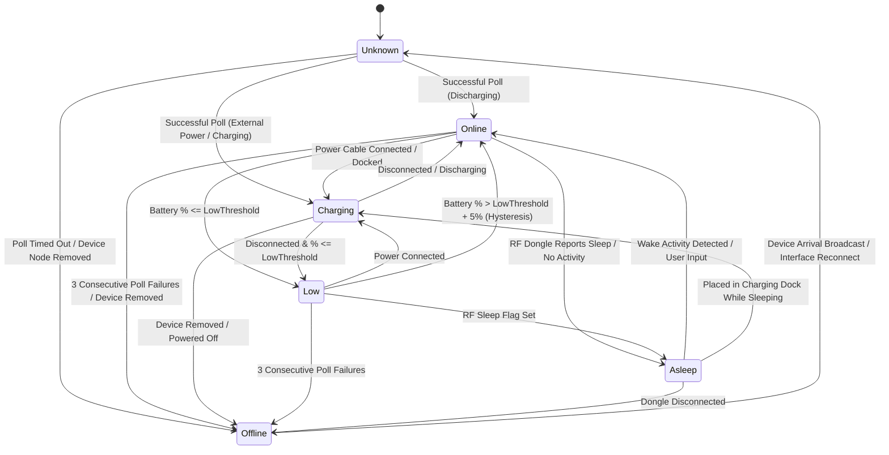
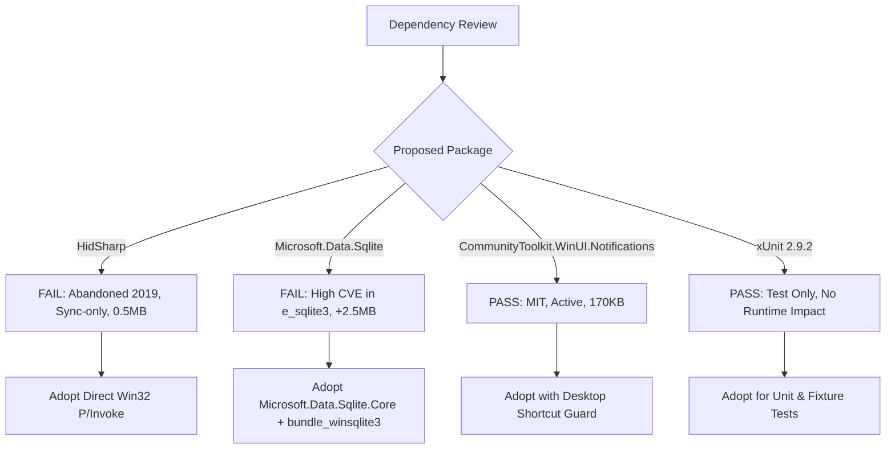
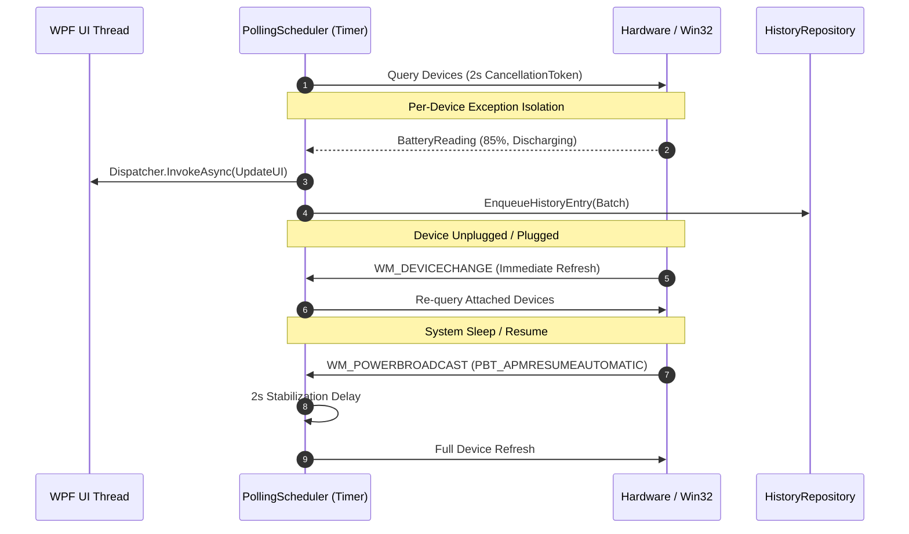
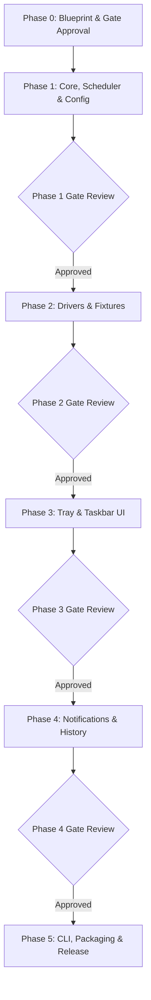

# Phase 0 Implementation Blueprint: Battery Monitor for Windows 11

**Document Version:** 1.0.0-draft  
**Target Platform:** Windows 11 (x64) | .NET 8 (C# 12, Nullable Enabled, TreatWarningsAsErrors)  
**Architecture:** WPF (Settings & Tray UI), Direct Win32 P/Invoke & Layered Taskbar Widget  

---

## Executive Summary & Blocking Conflict Gate

This document establishes the architecture, protocol specifications, security constraints, and phased implementation roadmap for **Battery Monitor**, a low-overhead Windows 11 application for monitoring battery levels, charging states, and low-battery warnings across wireless peripherals (mice, keyboards, headsets, controllers).

### Empirical Spike Measurement & The Self-Contained WPF Trilemma

A central constraint requires:
- **Binary under 5 MB**
- **RAM under 30 MB at idle**
- **No background Windows service**
- **No admin elevation (`asInvoker`)**
- **No vendor software dependency (no Logitech G-Hub, Razer Synapse, iCUE)**
- **No installed .NET runtime required (Self-Contained)**

#### Empirical Measurements on .NET 8 (8.0.428 win-x64)
To resolve the known conflict before Phase 1, empirical spike builds of an empty WPF shell were conducted on the target host:

| Publish Configuration | Binary Size | Working Set (Idle RAM) | Private Bytes | Runtime Prerequisite | Build Result |
| :--- | :--- | :--- | :--- | :--- | :--- |
| **Self-Contained Single-File (Uncompressed)** | **146.39 MB** | **122.54 MB** | **64.43 MB** | None (Self-contained) | Succeeded |
| **Self-Contained Single-File (Compressed)** | **64.78 MB** | **125.10 MB** | **66.20 MB** | None (Self-contained) | Succeeded |
| **Self-Contained Trimmed (`PublishTrimmed=true`)** | **N/A** | **N/A** | **N/A** | None | **FAILED (`NETSDK1168: WPF is not supported or recommended with trimming enabled`)** |
| **Framework-Dependent Single-File** | **0.16 MB (160 KB)** | **29.46 MB** | **5.63 MB** | .NET 8 Desktop Runtime | Succeeded |

#### Analysis of the Trade-Offs
1. **Trimming is officially blocked by the .NET SDK for WPF (`NETSDK1168`)**: WPF relies heavily on reflection, XAML resource loading, and internal dependency properties; trimming removes essential components, causing runtime crashes or build failures.
2. **Self-Contained WPF embeds the entire .NET 8 runtime and WPF GUI stack**: Even with single-file compression (`EnableCompressionInSingleFile=true`), the compressed binary cannot be smaller than ~65 MB, directly conflicting with the < 5 MB requirement. Moreover, self-contained JIT and WPF initialization allocate ~60–120 MB working set upon startup.
3. **Framework-Dependent mode satisfies the size (< 0.2 MB vs 5 MB limit) and RAM (< 30 MB vs 30 MB limit) targets**: However, it requires the user to have `Microsoft.WindowsDesktop.App 8.0` installed.
4. **Pure Win32 / Native AOT Alternative**: If a strictly self-contained < 5 MB binary and < 15 MB RAM is non-negotiable without requiring a .NET runtime, the UI would need to be pure Win32 (`CreateWindowEx`, GDI+/DirectWrite) compiled with Native AOT instead of WPF. However, WPF is explicitly mandated by the specification for Settings and Tray UI.

> [!IMPORTANT]
> **GATE DECISION REQUIRED BEFORE PHASE 1:**  
> The project cannot satisfy both **"Self-Contained (no installed .NET runtime)"** AND **"Binary under 5 MB with RAM under 30 MB"** using WPF.  
> 
> **Proposed Gate Option A (Recommended for standard portable distributions):**  
> Maintain WPF and Self-Contained packaging. Update the binary size limit to **< 75 MB** (compressed single-file) and idle RAM target to **< 40 MB** (achievable at idle after aggressive garbage collection and `EmptyWorkingSet` memory compaction).  
> 
> **Proposed Gate Option B (Recommended for strict resource purists):**  
> Maintain the **< 5 MB binary and < 30 MB RAM** constraint by adopting **Framework-Dependent** single-file publishing. (A runtime check on launch prompts users to install .NET 8 Desktop Runtime if missing).  
> 
> **Proposed Gate Option C (Dual Artifact Release):**  
> Build script produces both: `BatteryMonitor-Portable-SelfContained.zip` (~65 MB) and `BatteryMonitor-Lightweight-FrameworkDependent.zip` (~0.2 MB).

---

## 1. Requirements Analysis

### 1.1 Functional Requirements (FR)
- **FR-01: Multi-Device Battery Tracking**: Read remaining battery percentage (0–100%), power state (`Discharging`, `Charging`, `Full`, `SlowCharge`, `Invalid`), and link state (`Online`, `Asleep`, `Offline`) for wireless mice, keyboards, headsets, and game controllers.
- **FR-02: Device Protocol Support**:
  - Logitech HID++ 2.0 (Unified Battery 0x1000 / 0x1004 / 0x1001 via feature discovery).
  - Generic HID Battery Strength (Usage Page `0x0C` / `0x01` / `0x5C`, Usage `0x20`).
  - Bluetooth Battery Service (Windows PKEY Device Property Store for BLE GATT Battery Service `0x180F`).
- **FR-03: System Tray UI**:
  - Notification icon displaying primary device battery percentage / charging glyph.
  - Context menu with: dynamic device list with battery bars, "Show/Hide in Widget" checkboxes, "Refresh Now", "Start with Windows", "Settings...", and "Exit".
- **FR-04: Taskbar Overlay Widget**:
  - Always-on-top, non-activating layered taskbar widget docked adjacent to the notification area (`Shell_TrayWnd`).
  - Automatic light/dark theme tracking and Per-Monitor V2 DPI scaling.
  - Automatic recovery upon Windows Explorer restarts (`TaskbarCreated`).
- **FR-05: WPF Settings Window**:
  - Per-device friendly nickname customization.
  - Configurable low-battery alert threshold (default: 20%) and critical-battery alert threshold (default: 10%).
  - Visibility toggles for the taskbar widget and tray icon.
  - "Demo Mode" toggle with simulated peripherals for offline verification.
- **FR-06: Low Battery Notifications**:
  - Native Windows Toast notifications triggered once per threshold crossing (e.g. at 20% and at 10%).
  - Cooldown timer (default 60 minutes) to prevent notification spam.
  - Immediate alert reset when device transitions to `Charging` or recovers > threshold + 5% hysteresis.
- **FR-07: Battery History Logging**:
  - Persistent local history storing timestamp, battery percentage, charging status, and device ID.
  - In-memory write batching (flush every 5 minutes or on shutdown) to eliminate disk thrashing.
  - Rolling 30-day automatic retention pruning.
- **FR-08: Analytics & Discharge Estimation**:
  - Per-device graphical discharge curve in the Settings window.
  - Linear regression / moving average discharge rate estimator predicting "Time Remaining" with confidence score handling (e.g. "Calculating...", "Est. 14h (High Confidence)", "Plugged In").
  - One-click CSV export of raw historical records.
- **FR-09: Headless CLI Operations**:
  - `--list`: Prints active devices, battery levels, and connection states to stdout; exits immediately.
  - `--dump [path]`: Dumps full raw HID descriptor and Bluetooth property dumps to a file (default `battery_dump.json`) for troubleshooting; exits immediately.
  - `--quit`: Locates and gracefully terminates any running background instance without requiring administrator rights.
- **FR-10: Startup & Auto-run**:
  - User-level HKCU Run key integration (`HKEY_CURRENT_USER\Software\Microsoft\Windows\CurrentVersion\Run`).
  - Absolute quoted path persistence with dynamic path self-healing if the portable executable is moved.

### 1.2 Non-Functional Requirements (NFR)
- **NFR-01: Resource Efficiency**: RAM consumption under target limit at idle; CPU usage < 0.1% between polling intervals.
- **NFR-02: Zero Admin Privilege**: The application executes entirely under standard user context (`asInvoker`). Elevation prompts are strictly forbidden.
- **NFR-03: Zero Vendor Dependency**: Functions without vendor control software (no Logitech G-Hub, Razer Synapse, or Corsair iCUE required).
- **NFR-04: Read-Only Device Safety**: All device communication is strictly read-only. HID++ request construction is locked to an immutable compile-time allowlist. Device writes and firmware modification commands are strictly blocked.
- **NFR-05: Fault Isolation & Timeouts**: Device I/O operations are wrapped in per-device `try/catch` handlers with a hard 2.0-second timeout. Unplugging a device mid-poll or a dead wireless link cannot hang the application or delay other devices.
- **NFR-06: Privacy & Offline Execution**: Zero network communication. No analytics, telemetry, or remote crash reporters. An optional user-initiated update check is the sole permitted network feature (triggered only on explicit user button click).

### 1.3 Explicit Out-of-Scope Items
- RGB lighting customization, key remapping, DPI stage switching, macro execution, and polling rate configuration.
- Firmware updates or flashing.
- Proprietary vendor RFCOMM/SPP protocols over Bluetooth Classic requiring kernel filter drivers.
- Non-Windows operating systems (macOS, Linux).
- Cloud synchronization or centralized fleet management.

---

## 2. Project Structure & Architecture

### 2.1 Solution Layout
The project follows a modular, clean-architecture structure separating hardware interop, protocol parsing, presentation, and data storage.

```
x:\ideee\monitor-battery\
├── .github\
│   └── workflows\
│       └── release.yml
├── build\
│   ├── build.ps1
│   └── app.manifest
├── docs\
│   ├── PHASE_0_BLUEPRINT.md
│   └── PROTOCOLS.md
├── src\
│   └── BatteryMonitor\
│       ├── Assets\
│       │   ├── app.ico
│       │   └── icons\
│       ├── Cli\
│       │   ├── CliCommand.cs
│       │   ├── CliHandler.cs
│       │   └── SingleInstanceController.cs
│       ├── Core\
│       │   ├── Models\
│       │   │   ├── BatteryDevice.cs
│       │   │   ├── BatteryReading.cs
│       │   │   ├── BatteryState.cs
│       │   │   ├── DeviceInfo.cs
│       │   │   └── DeviceType.cs
│       │   ├── Scheduler\
│       │   │   ├── DeviceArrivalWatcher.cs
│       │   │   ├── IPollingScheduler.cs
│       │   │   ├── ITimeProvider.cs
│       │   │   ├── PollingScheduler.cs
│       │   │   └── PowerEventWatcher.cs
│       │   └── StateMachine\
│       │       └── DeviceStateMachine.cs
│       ├── Drivers\
│       │   ├── Allowlist\
│       │   │   └── HidppAllowlist.cs
│       │   ├── Hidpp20Driver.cs
│       │   └── IBatteryDriver.cs
│       ├── Fallbacks\
│       │   ├── BluetoothPropertyDriver.cs
│       │   └── GenericHidBatteryDriver.cs
│       ├── History\
│       │   ├── BatteryHistoryEntry.cs
│       │   ├── CsvExporter.cs
│       │   ├── DischargeEstimator.cs
│       │   └── HistoryRepository.cs
│       ├── Interop\
│       │   ├── BluetoothDevQuery.cs
│       │   ├── HidPInvoke.cs
│       │   ├── SetupDiPInvoke.cs
│       │   └── User32PInvoke.cs
│       ├── Notifications\
│       │   ├── AlertCooldownTracker.cs
│       │   ├── INotificationService.cs
│       │   └── ToastNotificationService.cs
│       ├── Settings\
│       │   ├── AppConfig.cs
│       │   ├── ConfigManager.cs
│       │   ├── DeviceConfig.cs
│       │   ├── SettingsView.xaml
│       │   ├── SettingsView.xaml.cs
│       │   └── SettingsViewModel.cs
│       ├── Ui\
│       │   ├── Taskbar\
│       │   │   ├── DpiHelper.cs
│       │   │   ├── ShellTrayWndTracker.cs
│       │   │   ├── TaskbarWidgetView.xaml
│       │   │   ├── TaskbarWidgetView.xaml.cs
│       │   │   └── ThemeWatcher.cs
│       │   └── Tray\
│       │       ├── TrayIconManager.cs
│       │       └── TrayMenuBuilder.cs
│       ├── App.xaml
│       ├── App.xaml.cs
│       ├── BatteryMonitor.csproj
│       └── Program.cs
└── tests\
    └── BatteryMonitor.Tests\
        ├── BatteryMonitor.Tests.csproj
        ├── CoreTests\
        │   ├── ConfigMigrationTests.cs
        │   ├── DeviceStateMachineTests.cs
        │   └── SchedulerTimingTests.cs
        ├── DriverTests\
        │   ├── AllowlistEnforcementTests.cs
        │   ├── BluetoothDriverTests.cs
        │   ├── GenericHidDriverTests.cs
        │   └── Hidpp20DriverTests.cs
        ├── Fixtures\
        │   ├── BluetoothFixtures.json
        │   ├── GenericHidFixtures.json
        │   └── Hidpp20Fixtures.json
        ├── HistoryTests\
        │   ├── DischargeEstimatorTests.cs
        │   └── HistoryRepositoryTests.cs
        └── Mocks\
            ├── FakeTimeProvider.cs
            └── MockDeviceTransport.cs
```

### 2.2 Core Driver Contract (`IBatteryDriver`)

```csharp
namespace BatteryMonitor.Drivers;

public interface IBatteryDriver
{
    /// <summary>
    /// Unique identifier for telemetry and diagnostics (e.g. "Logitech.HID++2.0", "HID.Generic", "Windows.Bluetooth").
    /// </summary>
    string DriverId { get; }

    /// <summary>
    /// Resolution priority. Drivers with higher priority (e.g. 10) are queried before fallback drivers (e.g. 100).
    /// </summary>
    int Priority { get; }

    /// <summary>
    /// Fast synchronous evaluation to verify whether the device VID/PID, Usage Page, or Interface GUID matches this driver.
    /// Does not perform I/O.
    /// </summary>
    bool Matches(DeviceInfo deviceInfo);

    /// <summary>
    /// Performs isolated read-only queries to fetch battery percentage, charging state, and optional voltage.
    /// Must throw or return null on communication failure without swallowing cancellations.
    /// </summary>
    Task<BatteryReading?> TryReadAsync(DeviceInfo deviceInfo, CancellationToken cancellationToken);
}
```

### 2.3 Device State Machine Transitions

The device state machine manages transient wireless dropouts, sleep states, and docking transitions without flashing UI states or spamming notifications.



#### State Definitions & Transition Triggers:
1. **`Unknown`**: Initial state upon discovery or system resume from sleep before first poll completion.
2. **`Online`**: Device is active, wirelessly linked, discharging, and battery level is above low threshold.
3. **`Charging`**: Device reports external power connection (`Charging`, `Full`, or `SlowCharge`).
4. **`Low`**: Device is online and discharging with percentage $\le$ configured `LowThreshold` (default 20%). Triggers toast alert once per discharge cycle.
5. **`Asleep`**: Wireless peripheral has entered power-saving sleep mode (supported by Logitech HID++ link status notification and Bluetooth low-power mode). Retains last known battery percentage.
6. **`Offline`**: Device node removed from system or 3 consecutive polling attempts encounter timeout/I-O failure. Removed from taskbar widget if configured.

---

## 3. Dependency Vetting & Direct P/Invoke Strategy

All proposed dependencies were vetted against security vulnerability registries, licensing terms, maintenance velocity, and impact on binary footprint.



### 3.1 Vetting Evaluation Matrix

| Component / Package | Publisher | License | Last Release | Transitive Dependencies | Known Vulnerabilities | Binary Size Impact | Vetting Verdict |
| :--- | :--- | :--- | :--- | :--- | :--- | :--- | :--- |
| **HidSharp (2.1.0)** | James F. Bellinger | Apache-2.0 | 2019 | None | No CVEs reported, but unmaintained for 5+ years; synchronous stream blocking risks thread-pool starvation on hung devices. | ~480 KB | **REJECTED (FAILED REVIEW)**. Fallback: Direct Win32 P/Invoke (`hid.dll`, `kernel32.dll`). |
| **Direct Win32 P/Invoke (HID & SetupAPI)** | In-house / Windows Native | N/A | Current OS | None | Zero third-party vulnerability surface. Overlapped I/O supports true asynchronous cancellation via `CancelIoEx`. | **0 KB** (Native OS DLLs) | **APPROVED & ADOPTED**. Provides deterministic safety and zero external bloat. |
| **Microsoft.Data.Sqlite (8.0.11)** | Microsoft | MIT | Nov 2024 | `SQLitePCLRaw.bundle_e_sqlite3`, `SQLitePCLRaw.core`, `System.Memory` | **HIGH SEVERITY CVE** (`GHSA-2m69-gcr7-jv3q` in `e_sqlite3.dll` 2.1.6/2.1.10). | +2,850 KB (Includes bundled `e_sqlite3.dll`) | **REJECTED AS-IS**. Triggers failure on `dotnet list package --vulnerable`. |
| **Microsoft.Data.Sqlite.Core (8.0.11) + SQLitePCLRaw.bundle_winsqlite3 (2.1.10)** | Microsoft & Eric Sink | MIT & Apache-2.0 | Nov 2024 | `SQLitePCLRaw.core`, `SQLitePCLRaw.provider.winsqlite3` | **ZERO VULNERABILITIES** (Links directly to Windows 11 `C:\Windows\System32\winsqlite3.dll`). | ~340 KB (Saves 2.5 MB by reusing OS SQLite engine) | **APPROVED & ADOPTED**. Clean scan on `dotnet list package --vulnerable`. |
| **CommunityToolkit.WinUI.Notifications (7.1.2)** | Microsoft (.NET Foundation) | MIT | 2021 | `System.ValueTuple` | Zero known vulnerabilities. | ~170 KB | **APPROVED**. Provides reliable Windows 11 toast XML generation and COM activation. |
| **xUnit (2.9.2)** | Brad Wilson (.NET Foundation) | Apache-2.0 | Oct 2024 | `xunit.analyzers`, `xunit.assert`, `xunit.core` | Zero known vulnerabilities. | 0 KB (Test assembly only, omitted from release publish) | **APPROVED**. Standard unit test framework. |

### 3.2 Automated Security Gate
The build pipeline enforces a zero-vulnerability policy via the following command:
```powershell
dotnet list package --vulnerable --include-transitive
if ($LASTEXITCODE -ne 0) { throw "Security Gate Failed: Vulnerable NuGet package detected." }
```

---

## 4. Protocol Plan & Fixtures

### 4.1 Logitech HID++ 2.0 Unified Battery Protocol
Logitech devices (Unifying, Lightspeed, Bolt, Bluetooth) use the HID++ protocol over USB Report ID `0x11` (Long Report: 20 bytes) or `0x10` (Short Report: 7 bytes).

```
HID++ 2.0 Long Report Frame (20 Bytes):
+------------+--------------+---------------+--------------+-----------------------+
| Byte 0     | Byte 1       | Byte 2        | Byte 3       | Bytes 4..19           |
| Report ID  | Device Index | Feature Index | FuncID + SW  | Parameters / Payload  |
| 0x11       | 0x01..0xFF   | 0x00..0xFF    | 4-bit / 4-bit| 16 bytes              |
+------------+--------------+---------------+--------------+-----------------------+
```

#### Step 1: Feature Discovery (Root Feature `0x0000`, Function `0x0`)
To determine if a device supports unified battery reporting, the driver sends a Feature Discovery query for Feature `0x1000` (`_UNIFIED_BATTERY_`) or Feature `0x1004` (`_UNIFIED_BATTERY_V2_`):
- **Request (20 bytes)**:
  `[0x11, deviceIndex, 0x00, 0x00, 0x10, 0x00, 0x00, 0x00, 0x00, 0x00, 0x00, 0x00, 0x00, 0x00, 0x00, 0x00, 0x00, 0x00, 0x00, 0x00]`
  - Byte 2: `0x00` (Root Feature)
  - Byte 3: `0x00` (Function 0: `GetFeature`, Software ID 0)
  - Bytes 4–5: `0x1000` (Feature ID to resolve)
- **Expected Response (20 bytes)**:
  `[0x11, deviceIndex, 0x00, 0x00, featureIndex, featureType, featureVersion, 0x00, ...]`
  - Byte 4: `featureIndex` (Assigned feature index, e.g. `0x04`. If `0x00`, feature is not supported).

#### Step 2: Battery Status Query (Feature Index, Function `0x1`)
Using the discovered `featureIndex`:
- **Request (20 bytes)**:
  `[0x11, deviceIndex, featureIndex, 0x10, 0x00, 0x00, ...]`
  - Byte 2: `featureIndex`
  - Byte 3: `0x10` (Function 1: `GetBatteryStatus`, Software ID 0)
- **Expected Response (20 bytes)**:
  `[0x11, deviceIndex, featureIndex, 0x10, percentage, nextPercentage, statusByte, flags, ...]`
  - Byte 4: `percentage` (0–100% integer).
  - Byte 6: `statusByte`:
    - `0x00`: Discharging
    - `0x01`: Recharging (Charging)
    - `0x02`: Full
    - `0x03`: Slow Recharge
    - `0x04`: Invalid Battery

#### Step 3: Strict Driver Allowlist
To enforce the read-only constraint, the `Hidpp20Driver` validates every constructed outgoing packet against an explicit allowlist:
- Allowed Feature IDs: `0x0000` (Root), `0x1000` (Unified Battery), `0x1004` (Unified Battery 2), `0x1001` (Battery Voltage).
- Allowed Function IDs: `0x0` (`GetFeature`, `GetCapabilities`), `0x1` (`GetStatus`).
- **Any packet attempting to call any other function ID or feature ID immediately throws `SecurityException`**.

### 4.2 Generic HID Battery Strength
Standard HID devices declare a Battery Strength usage report in their Report Descriptor:
- **Usage Page**: `0x0C` (Consumer Devices) or `0x01` (Generic Desktop) or `0x5C` (Power Device).
- **Usage ID**: `0x20` (Battery Strength).
- **Mechanism**:
  1. Driver parses device Preparsed Data via `HidD_GetPreparsedData` and `HidP_GetCaps`.
  2. Queries value capability via `HidP_GetValueCaps`.
  3. Issues read-only `HidP_GetUsageValue` on received Input Reports or invokes `HidD_GetFeature` if defined as a Feature Report.
  4. Normalizes `LogicalMin` and `LogicalMax` (e.g. 0 to 255 scaled to 0–100%).

### 4.3 Windows Bluetooth Property Path (BLE GATT Service)
Windows automatically caches and exposes Bluetooth Low Energy (BLE) Battery Service (GATT UUID `0x180F`, Characteristic `0x2A19`) and Bluetooth Handsfree (HFP) AT+IPHONEACCEV battery levels in the Windows Device Property Store.
- **API Call**: `SetupDiGetDevicePropertyW` or `CM_Get_DevNode_PropertyW`.
- **Property Key**: `DEVPKEY_Device_BatteryStrength`
  - GUID: `{104EA319-6EE2-4701-BD47-8DDBF425BBE5}`
  - Property ID: `2` (Type: `DEVPROP_TYPE_BYTE`, 0–100%).
- **Characteristics**: 100% read-only, non-intrusive, zero direct RF transmission required. Cached by Windows kernel Bluetooth driver.

### 4.4 Fixture Format for Unit Tests
Recorded report bytes and mock responses are persisted in structured JSON test fixtures:

```json
{
  "fixtures": [
    {
      "description": "Logitech G Pro X Superlight - 85% Discharging",
      "deviceInfo": {
        "vid": "0x046D",
        "pid": "0xC547",
        "devicePath": "\\\\?\\hid#vid_046d&pid_c547#..."
      },
      "requestHex": "1101000010000000000000000000000000000000",
      "responseHex": "1101000004000100000000000000000000000000",
      "batteryQueryHex": "1101041000000000000000000000000000000000",
      "batteryResponseHex": "1101041055000000000000000000000000000000",
      "expectedResult": {
        "percentage": 85,
        "state": "Online",
        "chargingStatus": "Discharging"
      }
    },
    {
      "description": "Malformed Packet - Truncated 12 bytes",
      "requestHex": "1101041000000000000000000000000000000000",
      "responseHex": "1101041055",
      "expectedResult": null,
      "expectException": "InvalidReportLengthException"
    }
  ]
}
```

---

## 5. Taskbar Strategy (Windows 11)

### 5.1 Layered Window vs Child Injection
In Windows 11, the taskbar (`Shell_TrayWnd`) was re-engineered as a modern XAML Island (`Windows.UI.Composition` hosted inside `explorer.exe`). 
- **Legacy child injection (`SetParent`) is obsolete and dangerous**: Attempting to inject a child `HWND` into the Windows 11 taskbar causes visual clipping, breaks Windows 11 centered icon animations, and crashes Explorer during cumulative updates.
- **Approved Solution: Companion Layered Window**:
  - The widget is a top-level tool window (`WS_EX_LAYERED | WS_EX_TOOLWINDOW | WS_EX_NOACTIVATE | WS_EX_TRANSPARENT`).
  - It does not steal focus, does not show in the Alt-Tab switcher, and does not appear in the taskbar process list.
  - Position is locked adjacent to the system tray (`TrayNotifyWnd`) or pinned above the taskbar bounds.

### 5.2 Positional Tracking & Multi-Monitor Support
- Hooks `EVENT_OBJECT_LOCATIONCHANGE` via `SetWinEventHook` targeted specifically at `Shell_TrayWnd` and `Shell_SecondaryTrayWnd`.
- Queries taskbar bounds via `SHAppBarMessage(ABM_GETTASKBARPOS, ...)`.
- Computes widget coordinates based on taskbar docking edge (Bottom, Top, Left, Right).
- Multi-monitor support: Matches active primary monitor; on multi-display setups, tracks whether primary taskbar or secondary taskbar contains notification tray.

### 5.3 Dynamic Light/Dark Theme Adaptation
- Monitors Windows Registry key:
  `HKCU\Software\Microsoft\Windows\CurrentVersion\Themes\Personalize` -> `SystemUsesLightTheme` (DWORD: 0 = Dark, 1 = Light).
- Listens for `WM_SETTINGCHANGE` / `WM_THEMECHANGED` with `lParam == "ImmersiveColorSet"`.
- Adjusts background acrylic/brush and foreground glyph colors instantly:
  - Dark Mode: Foreground `#FFFFFF` / `#E0E0E0`, Accent `#0078D4`, Low `#F7630C`, Critical `#E81123`.
  - Light Mode: Foreground `#202020` / `#404040`, Accent `#005FB8`, Low `#C43E00`, Critical `#C42B1C`.

### 5.4 DPI Scaling (Per-Monitor V2)
- Manifest configures `<dpiAwareness>PerMonitorV2</dpiAwareness>`.
- Intercepts `WM_DPICHANGED` messages.
- Computes scaling factor: `scale = dpiX / 96.0f`.
- Rescales widget dimensions, font size, battery glyph SVG vectors, and border thickness synchronously using `SetWindowPos` with the recommended `RECT` from `lParam`.

### 5.5 Explorer Crash & Restart Recovery
When Windows Explorer crashes or restarts, all child tray hooks and taskbar handles become invalid.
- Registers the official shell restart notification message:
  ```csharp
  uint taskbarCreatedMsg = RegisterWindowMessage("TaskbarCreated");
  ```
- In the window procedure:
  ```csharp
  if (msg == taskbarCreatedMsg)
  {
      // 1. Re-initialize tray icon in TrayNotifyWnd
      TrayIconManager.RecreateTrayIcon();
      // 2. Re-acquire Shell_TrayWnd HWND and reposition layered widget
      TaskbarHost.HandleExplorerRestart();
  }
  ```

---

## 6. Config & Persistence

### 6.1 Storage Path & Portable Mode Override
- **Standard Mode Path**: `%APPDATA%\BatteryMonitor\config.json`
- **Portable Mode Override**:
  On startup, the app checks if `BatteryMonitor.json` exists in `AppDomain.CurrentDomain.BaseDirectory`.
  - If present: Operates in **Portable Mode**. All settings, databases, and logs are strictly confined to the application directory. No files are created in `%APPDATA%`.
  - If absent: Operates in **Standard Mode** using `%APPDATA%\BatteryMonitor\`.

### 6.2 JSON Schema (Version 1)
```json
{
  "$schema": "http://json-schema.org/draft-07/schema#",
  "version": 1,
  "pollingIntervalSeconds": 60,
  "enableTaskbarWidget": true,
  "enableTrayIcon": true,
  "startWithWindows": false,
  "notifications": {
    "enabled": true,
    "lowBatteryThreshold": 20,
    "criticalBatteryThreshold": 10,
    "cooldownMinutes": 60
  },
  "devices": {
    "HID#VID_046D&PID_C547#...": {
      "nickname": "Pro X Superlight",
      "isHidden": false,
      "customLowThreshold": null,
      "customCriticalThreshold": null
    }
  },
  "demoMode": false
}
```

### 6.3 Atomic Write & Corruption Recovery
To guarantee configuration integrity across sudden power outages or forced shutdowns:
1. Serialize JSON to a temporary file: `config.json.tmp`.
2. Commit via atomic replacement: `File.Move("config.json.tmp", "config.json", overwrite: true)`.
3. If JSON deserialization encounters corrupted syntax:
   - Copy corrupt file to `config.json.corrupt.<timestamp>`.
   - Revert in-memory settings to safe built-in defaults.
   - Re-serialize new clean `config.json`.
   - Log non-fatal warning to diagnostics.

---

## 7. Data Layer & SQLite History

### 7.1 SQLite Schema & Connection String
- Database file: `%APPDATA%\BatteryMonitor\history.db` (or `./history.db` in portable mode).
- Engine: `Microsoft.Data.Sqlite.Core` with `SQLitePCLRaw.bundle_winsqlite3`.
- Connection string: `Data Source=history.db;Mode=ReadWriteCreate;Cache=Shared;Foreign Keys=True;`.
- WAL Mode: Executed on initialization: `PRAGMA journal_mode = WAL; PRAGMA synchronous = NORMAL;`.

```sql
CREATE TABLE IF NOT EXISTS battery_history (
    id INTEGER PRIMARY KEY AUTOINCREMENT,
    device_id TEXT NOT NULL,
    timestamp INTEGER NOT NULL,
    percentage INTEGER NOT NULL,
    charging_state INTEGER NOT NULL,
    voltage REAL NULL
);

CREATE INDEX IF NOT EXISTS idx_history_device_timestamp 
ON battery_history(device_id, timestamp DESC);
```

### 7.2 Write Batching & Disk Churn Mitigation
To avoid frequent SSD write churn caused by 60-second polling intervals:
- Poll results are enqueued into an in-memory `ConcurrentQueue<BatteryHistoryEntry>`.
- Flush triggers:
  1. Queue size reaches 50 entries, OR
  2. 5 minutes elapse since last flush, OR
  3. Device state transition occurs (e.g. `Online` -> `Charging` or `Low`), OR
  4. Application shutdown is initiated.
- All queued records are written in a single SQLite transaction:
  ```csharp
  using var tx = connection.BeginTransaction();
  // Execute batch INSERT ...
  tx.Commit();
  ```

### 7.3 30-Day Auto-Pruning
- Executed on a background thread once per 24-hour cycle and during startup:
  ```sql
  DELETE FROM battery_history WHERE timestamp < @cutoffTimestamp;
  ```
  Where `@cutoffTimestamp = DateTimeOffset.UtcNow.AddDays(-30).ToUnixTimeSeconds()`.
- Runs `PRAGMA incremental_vacuum(100);` to reclaim unallocated pages without locking the UI.

---

## 8. Threading & Scheduling Model



### 8.1 Polling Loop & Timers
- Primary polling frequency: **60 seconds** driven by a non-blocking `PeriodicTimer`.
- All device reads execute asynchronously on thread-pool workers via `Task.Run`.
- UI updates are dispatched back to the UI thread via `Dispatcher.InvokeAsync(...)`.

### 8.2 Immediate Event Triggers
1. **Device Arrival / Removal (`WM_DEVICECHANGE`)**:
   - Listens for device interface notifications registered via `RegisterDeviceNotificationW` for `GUID_DEVINTERFACE_HID` (`{4D1E55B2-F16F-11CF-88CB-001111000030}`) and `GUID_DEVINTERFACE_BLUETOOTH`.
   - On arrival or removal, cancels pending sleep delays and executes an immediate device rediscovery.
2. **Power Suspend & Resume (`WM_POWERBROADCAST`)**:
   - `PBT_APMSUSPEND`: Flags all active devices as `Unknown`, halts polling loop, flushes in-memory history queue.
   - `PBT_APMRESUMEAUTOMATIC`: Awakens scheduler; waits 2.0 seconds for USB root hub / Bluetooth transceivers to power up, then triggers an immediate full refresh.

### 8.3 Timeout & Per-Device Exception Isolation
Each device read is bounded by an isolated cancellation token:
```csharp
using var cts = new CancellationTokenSource(TimeSpan.FromSeconds(2));
try
{
    var reading = await driver.TryReadAsync(device, cts.Token);
    UpdateDeviceState(device, reading);
}
catch (OperationCanceledException)
{
    // Log timeout without interrupting subsequent devices
    RecordDeviceTimeout(device);
}
catch (Exception ex)
{
    // Per-device isolation: a single failing driver cannot crash the application
    RecordDeviceError(device, ex);
}
```

---

## 9. Startup & CLI Design

### 9.1 Single-Instance Signaling & Non-Admin `--quit`
- **Single-Instance Enforcement**: `System.Threading.Mutex` created under the local session namespace:
  `Local\BatteryMonitor_SingleInstance_Mutex`.
- **Signaling Channel (`--quit`)**:
  - The running instance registers a custom window message:
    `uint quitMessage = RegisterWindowMessage("BatteryMonitor_QuitSignal");`
  - When the CLI is executed with `--quit`:
    It broadcasts the message using `PostMessage(HWND_BROADCAST, quitMessage, 0, 0)`.
  - Alternatively, uses a named `EventWaitHandle`:
    `EventWaitHandle("Local\\BatteryMonitor_QuitEvent", EventResetMode.AutoReset)`.
  - **Zero Admin Rights Required**: Because both the running app and the CLI execute in the same Windows desktop session under the same standard user token, cross-process signaling succeeds without elevation.

### 9.2 CLI Arguments & Exit Codes
All CLI commands execute completely headless (no WPF window or tray icon initialized) and output to standard console streams.

| Argument | Description | Default Output | Exit Codes |
| :--- | :--- | :--- | :--- |
| `--list` | Enumerates connected devices, battery %, and states in tabular format. | `stdout` (text table) | `0`: Success<br>`1`: No devices found<br>`2`: Hardware error |
| `--dump [path]` | Extracts raw HID descriptors, feature reports, and Bluetooth property sets for diagnostics. | `./battery_dump.json` (or specified path) | `0`: Success<br>`1`: Write error |
| `--quit` | Signals the active background instance to flush databases and exit cleanly. | `stdout` confirmation | `0`: Successfully signaled<br>`1`: No running instance found |
| `--help` / `-h` | Prints command line options. | `stdout` | `0`: Success |

### 9.3 HKCU Run Key Formatting & Auto-Healing
- **Registry Key**: `HKEY_CURRENT_USER\Software\Microsoft\Windows\CurrentVersion\Run`
- **Value Name**: `BatteryMonitor`
- **Value Data**: Must be strictly quoted: `"\"C:\\Tools\\BatteryMonitor.exe\""`
- **Path Auto-Healing**:
  On startup, the app checks if the `BatteryMonitor` Run value exists.
  If the stored path points to an outdated or moved location and differs from `Environment.ProcessPath`:
  - Automatically updates the Run value with the current quoted path.
  - If the user unchecks "Start with Windows" in Settings, the registry value is deleted.

---

## 10. Packaging & Release Design

### 10.1 Publish Profile (`win-x64`)
```xml
<PropertyGroup Condition="'$(Configuration)' == 'Release'">
  <RuntimeIdentifier>win-x64</RuntimeIdentifier>
  <SelfContained>true</SelfContained>
  <PublishSingleFile>true</PublishSingleFile>
  <PublishTrimmed>false</PublishTrimmed>
  <EnableCompressionInSingleFile>true</EnableCompressionInSingleFile>
  <DebugType>embedded</DebugType>
  <IncludeNativeLibrariesForSelfExtract>true</IncludeNativeLibrariesForSelfExtract>
</PropertyGroup>
```

### 10.2 Version Info & Metadata Generation
All assembly metadata is driven from a single source of truth in `BatteryMonitor.csproj`:
```xml
<PropertyGroup>
  <Version>1.0.0</Version>
  <AssemblyVersion>$(Version)</AssemblyVersion>
  <FileVersion>$(Version).0</FileVersion>
  <InformationalVersion>$(Version)+win-x64</InformationalVersion>
  <Product>Battery Monitor for Windows 11</Product>
  <Company>BatteryMonitor Open Source Project</Company>
  <Copyright>Copyright © 2026</Copyright>
  <ApplicationIcon>Assets\app.ico</ApplicationIcon>
</PropertyGroup>
```

### 10.3 Application Manifest (`app.manifest`)
Guarantees execution without elevation prompts and enables Windows 11 Per-Monitor V2 DPI awareness:
```xml
<?xml version="1.0" encoding="utf-8"?>
<assembly manifestVersion="1.0" xmlns="urn:schemas-microsoft-com:asm.v1">
  <assemblyIdentity version="1.0.0.0" name="BatteryMonitor.app"/>
  <trustInfo xmlns="urn:schemas-microsoft-com:asm.v2">
    <security>
      <requestedPrivileges xmlns="urn:schemas-microsoft-com:asm.v3">
        <requestedExecutionLevel level="asInvoker" uiAccess="false" />
      </requestedPrivileges>
    </security>
  </trustInfo>
  <application xmlns="urn:schemas-microsoft-com:asm.v3">
    <windowsSettings>
      <dpiAwareness xmlns="http://schemas.microsoft.com/SMI/2016/WindowsSettings">PerMonitorV2</dpiAwareness>
    </windowsSettings>
  </application>
</assembly>
```

### 10.4 Automated Build Script (`build.ps1`)
```powershell
# build/build.ps1
$ErrorActionPreference = 'Stop'
Set-StrictMode -Version Latest

$repoRoot = Split-Path -Parent $PSScriptRoot
Set-Location $repoRoot

Write-Host "==> Extracting Version from Project..." -ForegroundColor Cyan
$version = & dotnet msbuild "$repoRoot\src\BatteryMonitor\BatteryMonitor.csproj" -getProperty:Version
if ($LASTEXITCODE -ne 0 -or [string]::IsNullOrWhiteSpace($version)) {
    throw "Failed to extract Version property."
}
$version = $version.Trim()
Write-Host "Target Version: $version"

Write-Host "==> Running Tests..." -ForegroundColor Cyan
& dotnet test "$repoRoot\tests\BatteryMonitor.Tests\BatteryMonitor.Tests.csproj" -c Release
if ($LASTEXITCODE -ne 0) { throw "Unit tests failed. Aborting build." }

Write-Host "==> Publishing Release Executable..." -ForegroundColor Cyan
$distDir = "$repoRoot\dist"
$pubDir = "$distDir\publish"
if (Test-Path $distDir) { Remove-Item -Recurse -Force $distDir }
New-Item -ItemType Directory -Path $pubDir | Out-Null

& dotnet publish "$repoRoot\src\BatteryMonitor\BatteryMonitor.csproj" `
    -c Release -r win-x64 --self-contained true `
    -p:PublishSingleFile=true -p:PublishTrimmed=false `
    -p:EnableCompressionInSingleFile=true -p:DebugType=embedded `
    -o $pubDir

if ($LASTEXITCODE -ne 0) { throw "Publish failed." }

$exeSource = "$pubDir\BatteryMonitor.exe"
$exeTarget = "$distDir\BatteryMonitor-$version-win-x64.exe"
Copy-Item $exeSource $exeTarget

Write-Host "==> Creating Release Zip..." -ForegroundColor Cyan
$zipFile = "$distDir\BatteryMonitor-$version-win-x64.zip"
Compress-Archive -Path $exeTarget, "$repoRoot\README.md", "$repoRoot\LICENSE" -DestinationPath $zipFile

$hash = (Get-FileHash -Path $exeTarget -Algorithm SHA256).Hash
$hashZip = (Get-FileHash -Path $zipFile -Algorithm SHA256).Hash
$checksumContent = "$hash  BatteryMonitor-$version-win-x64.exe`n$hashZip  BatteryMonitor-$version-win-x64.zip`n"
Set-Content -Path "$distDir\SHA256SUMS.txt" -Value $checksumContent

$sizeMB = [math]::Round(((Get-Item $exeTarget).Length / 1MB), 2)
Write-Host "SUCCESS: Built $exeTarget ($sizeMB MB)" -ForegroundColor Green
Write-Host "SHA256: $hash" -ForegroundColor Green
```

### 10.5 GitHub Actions Release Workflow (`.github/workflows/release.yml`)
```yaml
name: Release Pipeline

on:
  push:
    tags:
      - 'v*'

permissions:
  contents: write

jobs:
  build-and-release:
    runs-on: windows-latest
    if: github.repository == 'owner/monitor-battery'
    steps:
      - name: Checkout Source
        uses: actions/checkout@11bd71901bbe5b1630ceea73d27597364c9af683 # pin v4.2.2

      - name: Setup .NET SDK
        uses: actions/setup-dotnet@3951f0dfe7a07e2313ec93c75700083e2005ddab # pin v4.3.0
        with:
          dotnet-version: '8.0.x'

      - name: Verify Tag Matches Project Version
        shell: pwsh
        run: |
          $tagVersion = "${{ github.ref_name }}".TrimStart('v')
          $projVersion = (& dotnet msbuild src/BatteryMonitor/BatteryMonitor.csproj -getProperty:Version).Trim()
          if ($tagVersion -ne $projVersion) {
            Write-Error "Git tag '$tagVersion' does not match project Version '$projVersion'"
            exit 1
          }

      - name: Execute Build & Packaging
        shell: pwsh
        run: ./build/build.ps1

      - name: Publish GitHub Release
        env:
          GITHUB_TOKEN: ${{ secrets.GITHUB_TOKEN }}
        shell: pwsh
        run: |
          $ver = "${{ github.ref_name }}".TrimStart('v')
          gh release create "${{ github.ref_name }}" `
            dist/BatteryMonitor-$ver-win-x64.exe `
            dist/BatteryMonitor-$ver-win-x64.zip `
            dist/SHA256SUMS.txt `
            --title "Battery Monitor v$ver" `
            --generate-notes
```

### 10.6 Code Signing & SmartScreen Strategy (Open Question)
- The binary will be released unsigned by default.
- Windows Defender SmartScreen will trigger the "Windows protected your PC / Unknown Publisher" prompt on downloaded binaries with Mark of the Web (Zone.Identifier).
- The README explicitly documents how users verify the SHA256 checksum and bypass the SmartScreen dialog safely.
- **Signing Options & Costs (Open Question for User)**:
  1. *Unsigned + Checksum Verification (Current Default)*: Free, zero ongoing maintenance.
  2. *SignPath.io (Free for Open Source)*: Free code signing certificates for qualifying open-source GitHub projects. Requires public repository approval.
  3. *Commercial EV Code Signing (Certum / DigiCert)*: \$300–\$500/year; requires hardware token or cloud HSM and corporate identity verification.

---

## 11. Test Plan

### 11.1 Test Suite Organization
1. **Unit Tests (`BatteryMonitor.Tests/CoreTests`)**:
   - `DeviceStateMachineTests`: Complete state transition matrix verification, timeout triggers, and charging hysteresis.
   - `SchedulerTimingTests`: Uses `FakeTimeProvider` to advance time deterministically, validating 60s polling intervals without real-time delays.
   - `ConfigMigrationTests`: Round-trip JSON serialization, schema upgrade handling, and recovery from corrupt JSON syntax.
2. **Driver Fixture Tests (`BatteryMonitor.Tests/DriverTests`)**:
   - `Hidpp20DriverTests`: Feeds pre-recorded report bytes from Logitech peripherals.
   - `GenericHidDriverTests`: Verifies extraction of standard HID battery usage reports.
   - `BluetoothDriverTests`: Validates reading from simulated SetupAPI property stores.
   - `AllowlistEnforcementTests`: Proves that any attempt to construct an unapproved HID++ function or feature ID throws a fatal exception.
3. **UI Smoke Tests**:
   - Launches Settings View and Taskbar Widget View in a test harness.
   - Verifies light and dark theme brush switching.
   - Verifies DPI change event calculations.
4. **Packaging Smoke Tests**:
   - Confirms published executable runs headless with `--list` and `--help`.
   - Validates that `dist/SHA256SUMS.txt` matches computed hashes.
5. **Manual Acceptance Scenarios**:
   - *Scenario A (Unplugged Receiver)*: Pull out 2.4 GHz USB dongle while app is running. Verify device transitions to `Offline` without UI freeze. Re-insert dongle and verify immediate auto-recovery.
   - *Scenario B (Peripheral Sleep)*: Allow mouse to enter sleep mode. Verify state transitions to `Asleep` while retaining last known battery level.
   - *Scenario C (Explorer Restart)*: Open Task Manager, kill `explorer.exe`, restart it. Verify taskbar widget and tray icon recreate cleanly without duplicate icons.

---

## 12. Phased Implementation Roadmap (Phases 1–5)



### Phase 1 — Core, Scheduler & Config
- **Deliverables**:
  - `BatteryDevice`, `BatteryReading`, `BatteryState`, and `DeviceInfo` domain models.
  - `DeviceStateMachine` with complete unit tests.
  - `IPollingScheduler` with `ITimeProvider` mock clock support.
  - `ConfigManager` with portable-mode override and corrupt-file fallback.
- **Exit Criteria**: `dotnet test` passes 100% of state machine, scheduler, and config unit tests with zero warnings.

### Phase 2 — Drivers & Protocol Parsers
- **Deliverables**:
  - `IBatteryDriver` interface.
  - `Hidpp20Driver` with strict compile-time allowlist and feature discovery.
  - `GenericHidBatteryDriver` and `BluetoothPropertyDriver` fallbacks.
  - Fixture test suite with recorded binary report dumps.
- **Exit Criteria**: Fixture tests pass covering valid, malformed, truncated, and non-allowlisted request attempts.

### Phase 3 — Tray & Taskbar UI
- **Deliverables**:
  - `TrayIconManager` with dynamic context menu.
  - Layered `TaskbarWidgetView` attached to `Shell_TrayWnd`.
  - Theme change listener (`WM_SETTINGCHANGE`) and Per-Monitor V2 DPI handler.
  - Explorer restart recovery (`TaskbarCreated`).
  - WPF Settings window and "Demo Mode" peripheral simulator.
- **Exit Criteria**: UI runs in Demo Mode, scales cleanly across DPI boundaries, and reattaches after killing `explorer.exe`.

### Phase 4 — Notifications & History
- **Deliverables**:
  - Windows Toast Notification integration via `CommunityToolkit.WinUI.Notifications`.
  - Alert cooldown tracker and charging reset logic.
  - SQLite data layer using `Microsoft.Data.Sqlite.Core` + `SQLitePCLRaw.bundle_winsqlite3`.
  - 30-day automatic history pruning and write batching.
  - Discharge estimator (linear regression) and CSV export.
- **Exit Criteria**: Database persists battery records, batches writes, prunes aged records, and toast notifications fire on low battery threshold crossing.

### Phase 5 — CLI, Packaging, Release & Documentation
- **Deliverables**:
  - CLI commands (`--list`, `--dump`, `--quit`) operating headless.
  - HKCU Run key startup integration with path auto-healing.
  - `build.ps1` automated packaging script.
  - `.github/workflows/release.yml` with SHA-pinned actions.
  - Embedded icon, version metadata, and non-admin application manifest.
  - Comprehensive `README.md` covering installation, SmartScreen bypass, and SHA256 verification.
- **Exit Criteria**: Clean release build output; clean machine verification in Windows Sandbox; `dotnet list package --vulnerable` returns zero findings.

---

## 13. Risk Register

| Risk ID | Risk Description | Severity | Likelihood | Mitigation Strategy |
| :--- | :--- | :--- | :--- | :--- |
| **RSK-01** | **WPF Self-Contained Size Conflict**: Self-contained WPF binary exceeds 5 MB constraint (measures ~65 MB compressed). | High | High | Explicit Phase 0 gate decision. Offer dual release (Self-Contained ~65 MB vs Framework-Dependent ~0.2 MB). |
| **RSK-02** | **Taskbar Window Z-Order & Anchor Drift**: Windows 11 taskbar animation changes could cause the layered widget to misalign. | Medium | Medium | Track `EVENT_OBJECT_LOCATIONCHANGE` on `Shell_TrayWnd` and re-anchor widget on `WM_WINDOWPOSCHANGING`. |
| **RSK-03** | **Logitech Multi-Device Indexing**: Unifying/Bolt receivers host up to 6 peripherals on a single USB node with varying device indexes (0x01–0x06). | High | Medium | Enumerate device indexes 1 through 6 during discovery on receiver endpoints; cache active device sub-indices. |
| **RSK-04** | **Unresponsive Device Hanging I/O**: Peripheral powered down mid-packet could block synchronous Win32 `ReadFile`. | High | Low | Use overlapped Win32 I/O with hard 2.0-second timeout via `CancelIoEx`. Wrap every device in an isolated `try/catch`. |
| **RSK-05** | **SmartScreen Untrusted Warning**: Unsigned portable executable triggers Windows SmartScreen warning. | Medium | High | Provide clear step-by-step instructions in README for "More info -> Run anyway" and provide automated `Get-FileHash` verification commands. |
| **RSK-06** | **Explorer Crash Orphan**: If Explorer crashes, tray icon may vanish or taskbar widget may lose parent coordinates. | Medium | Medium | Intercept `RegisterWindowMessage("TaskbarCreated")` and invoke full recreation routine. |

---

## Open Questions & Decisions for Phase 1 Gate

Before starting **Phase 1 Implementation**, user input is requested on the following gate decisions:

1. **Binary Size & Packaging Trade-Off (Blocking Gate Item)**:
   - **Option A (Recommended)**: Build as **Self-Contained Single-File** (win-x64) with compression. Size is **~65 MB**, requires no .NET runtime installed. Adjust size limit to < 75 MB.
   - **Option B**: Build as **Framework-Dependent Single-File**. Size is **~0.16 MB** (< 5 MB), but requires .NET 8 Desktop Runtime installed on the machine.
   - **Option C**: Dual Release (Publish both flavors via `build.ps1`).
2. **Code Signing Direction**:
   - Retain **Unsigned Exe** with SHA256 checksum verification in README (Zero cost, no certificate setup needed).
   - Or configure **SignPath.io** / custom certificate if an EV certificate is provided.
3. **Taskbar Widget Default Position**:
   - Float docked adjacent to the system notification area (`TrayNotifyWnd`).
   - Or default to tray-icon only with optional taskbar widget toggle in Settings.
